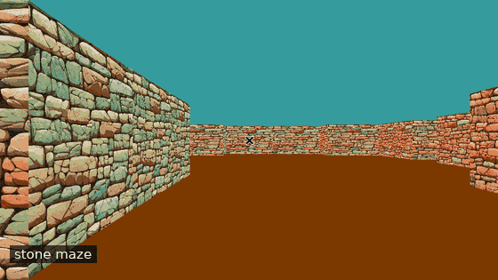
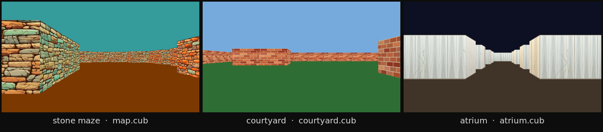
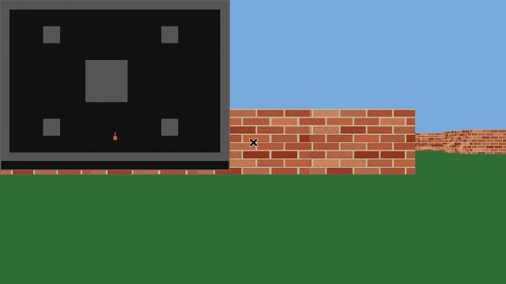
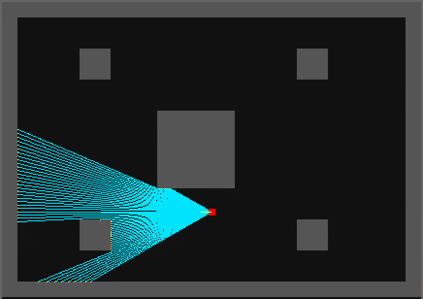

<div align="center">

# cub3D

*Wolfenstein 3D, minus the wolves, the guns, and the budget. Just walls, a camera, and a lot of math.*




</div>

Give it a `.cub` file and it gives you a first-person view of a textured maze: four wall textures,
painted floor and ceiling, movement, and a CPU renderer that never touches a GPU. Every pixel is
computed by hand and written into an X11 image buffer. The frame cap is ~60 fps; the cap is a
clock, not a promise.

## Three maps, one renderer



Same executable, same ray caster, three showcase `.cub` files — and three wall sets: rough stone
for the maze, red brick for the daylight courtyard, fluted cream marble for the night atrium.
The map picks its geometry, its four XPMs and its floor/ceiling colours; nothing about the scene
is compiled in. Run them with `./cub3D maps/courtyard.cub` and `./cub3D maps/atrium.cub`.

## What's in the box

| | |
|---|---|
| **Textured walls** | separate XPM per face (N/S/E/W), sampled per column with perspective-correct height |
| **Floor & ceiling** | solid colours parsed from the map file, `F 123,56,0` / `C 53,155,155` |
| **Movement** | `W A S D` to walk and strafe, `← →` to turn, `Esc` to leave |
| **Map format** | texture paths, RGB colours, `NSWE` spawn, `.cub` extension checked |
| **Sample maps** | stone maze, brick courtyard, marble atrium — each with its own four XPMs |
| **Validation** | flood fill proves the map is sealed; duplicate spawns and bad colours are rejected with a message |
| **Frame pacing** | capped at ~60 fps with `clock_gettime`, so it doesn't spin a core for nothing |

Bonus build (`make bonus`) adds collision, a live minimap, mouse look and the ray debug overlay:



The clip shows the collision check: walk into the wall, the camera stops, then `A` slides along
the face. The minimap tracks the same stop and slide. `M` hides the minimap; `R` draws the rays.

## How it was built: the minimap came first

The first version was not 3D. It was a top-down minimap: a grid of wall tiles, the player dot,
and a fan of lines for the rays. That view is still in the bonus build. Press `R` and the minimap
draws every 16th ray in cyan, with a yellow dot where each one hits a wall:



Once the 2D rays worked, the 3D view was mostly arithmetic:

1. Cast one ray per screen column: 640 columns, 60° field of view.
2. Keep the nearest wall segment and its distance.
3. Correct the distance with `cos(ray_angle - player_angle)` so straight walls do not bow.
4. Turn distance into height: `wall_height = TILE_SIZE * screen_height / distance`.
5. Sample the matching XPM column from top to bottom.

The minimap and the 3D view call the same `find_nearest_wall_hit`. That is why the fan on the
minimap lines up with the walls you see in first person: the visualisation is the renderer, not a
drawing of it.

## The pipeline

```text
map.cub ──▶ parser ──▶ grid + wall segments + 4 textures
                          │
   every frame ───────────┤
        keys/mouse ──▶ player x, y, angle
                          │
        640 rays  ──▶ nearest wall segment per ray
                          │
        distance ──▶ column height (÷ cos, no fisheye)
                          │
     texture column ──▶ pixel colour ──▶ mlx image ──▶ window
```

## Things that cost more time than expected

**Rays hit segments, not squares.** Instead of DDA-walking the grid, the parser turns every
wall tile edge into a line segment and each ray is tested against the whole list. It is brute
force in the best sense: any shape of map works, and a hit already carries the exact `x/y`
intersection needed for texture coordinates.

**Fisheye is a division away.** Raw ray distance grows towards the edges of the screen, so
straight walls look bowed. Multiplying by `cos(ray_angle - player_angle)` flattens the
projection before the column height is computed.

**Texture sampling has to survive close walls.** When a wall fills more than the screen, the
visible slice starts above the top edge. The texture `y` is offset by how far the column
overshoots, otherwise textures visibly stretch as you walk into them.

**Parsing is where maps go to die.** Textures are loaded before anything is drawn, the spawn is
checked for duplicates, colours for range, and a flood fill from the player must reach the whole
floor without touching the border. A hole in the wall is an error, not a weird view.

## Performance

The renderer is single-threaded C. The 16 ms timer is a cap, not a guarantee: the frame time goes
into writing roughly 3.6 million pixels at 2540×1440, so the real rate depends on resolution and
the machine. The Makefile builds with `-O2`; without it the same window is about three times
slower.

Texture size was the other dial. The sampler reads each XPM at its own size — the new brick and
marble sets are 256×256, the stone set is 900×900. We swapped the stone XPMs for 4K versions:
visually the same, still full speed. At 24K the XPM load took a noticeable pause and the frame
rate dropped, but it still rendered correctly. The limit there is the loader and memory
bandwidth, not the ray/segment loop.

The ray test is linear in the number of wall segments: 640 rays against every segment, every
frame. Fine at these map sizes; a grid or a BSP would be the next step for a much larger map.

## Build & run

```bash
make
./cub3D maps/map.cub
```

On gcc 14+ the bundled 42 MLX headers trip C23 checks, so build with:

```bash
make CC="gcc -std=gnu17"
```

Bonus features: `make bonus` (or `make BONUS=1`). Controls in the bonus build: mouse to look,
`M` to hide the minimap, `R` to show the ray fan.

## Loose ends

- Collision, minimap, mouse look and the ray fan live behind `BONUS=1`. The mandatory build
  walks through walls on purpose: the subject only asks for collision in the bonus, so adding it
  to the mandatory part would be out of scope.
- The ray overlay draws every 16th ray so the fan stays readable; the actual renderer casts one
  ray per screen column.
- Ray/segment tests are linear in the number of walls — fine at this map size, would want a grid
  or BSP for something huge.

## Layout

The numbers are my own convention, not a 42 rule. `main.c` is the entry point; the table is the
order it moves through the stages:

| # | Folder | Runs | Responsibility |
|---|--------|------|----------------|
| 0 | `src/0_parsing/` | once, at startup | reads the `.cub` file: textures, colours, spawn, flood fill |
| 1 | `src/1_input_handling/` | once, at startup | registers key press / release and window close |
| 2 | `src/2_engine_core/` | inside every ray | ray/segment intersection, nearest wall |
| 3 | `src/3_rendering/` | every frame | column height, texture pixels, minimap, ray debug |
| 4 | `src/4_game_loop/` | ~60×/s | movement, rotation, mouse look, frame pacing |

Under that, the files:

```text
src/main.c            entry point: parse, init MLX, open the window
src/0_parsing/        0_check_map.c … 4_parse_wall.c
src/1_input_handling/ input.c
src/2_engine_core/    raycaster.c
src/3_rendering/      0_renderer.c … 3_ray_debug.c
src/4_game_loop/      loop.c, mouse_handler.c
include/              shared structs and constants (FOV 60°, 640 rays)
maps/                 map.cub, courtyard.cub, atrium.cub + three texture sets
utils/                libft and get_next_line
docs/                 the recordings and the map triptych above
```

Where a stage has several files they are numbered in execution order (`0_check_map.c` …
`4_parse_wall.c`, `0_renderer.c` … `3_ray_debug.c`); single-file stages keep a plain name.

About **1,800 lines** of C in the 42 Norm house style: 80-column code, no `for` loops, one job
per function.

## Credits

42 Paris, by [@edouwarden](https://github.com/edouwarden) and Julien Sarter.
